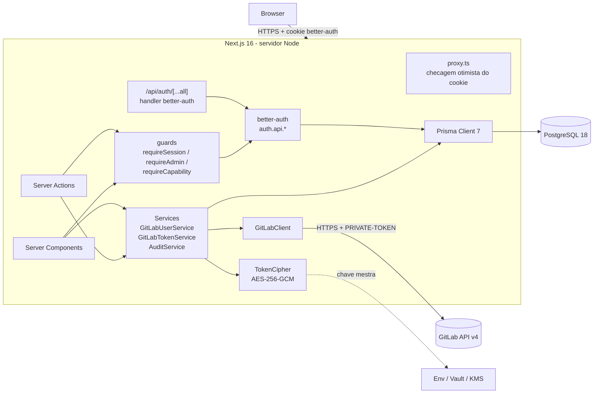
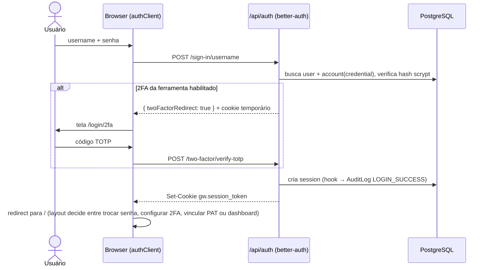
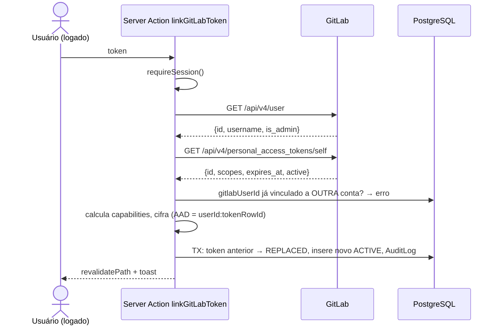
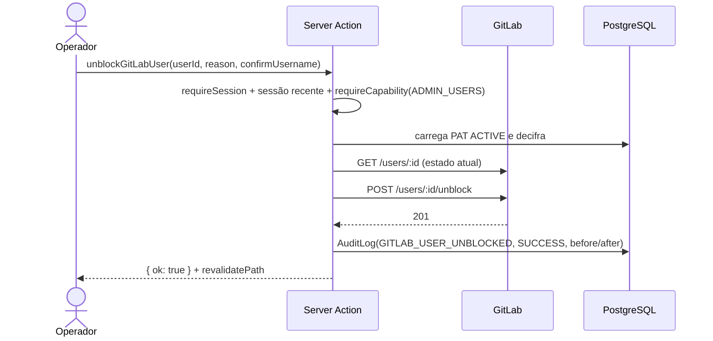
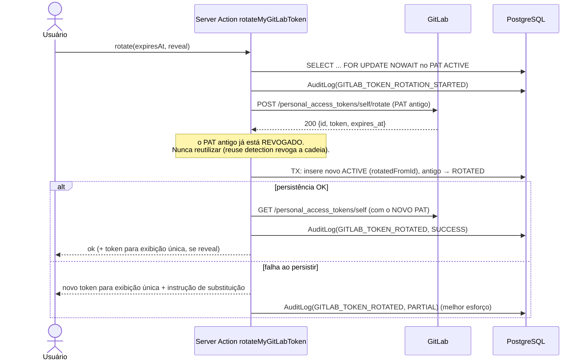

# 02 — Arquitetura

## 1. Stack

Versões exatas e justificativas estão em [10 — Dependências e versões](10-dependencias-e-versoes.md).

| Camada | Tecnologia | Observação |
|--------|-----------|------------|
| Runtime | **Node.js 26 LTS** | Next 16 exige ≥ 20.9 |
| Framework | **Next.js 16.4** (App Router, Turbopack, `proxy.ts`) + **React 19.3** | Server Components e Server Actions mantêm o PAT só no servidor |
| Linguagem | **TypeScript 6.0** (strict) | TS 7 ainda não é suportado pelo typescript-eslint |
| Autenticação | **better-auth 1.7** | `emailAndPassword` + plugins `username`, `twoFactor`, `admin`, `nextCookies` |
| UI | **Tailwind CSS 4.3** + **shadcn/ui** (CLI 4.x, estilo `base-nova` sobre **@base-ui/react**) + **lucide-react** + **sonner** | Tailwind via CSS (`@theme`). **Implementação:** sem Radix; tabelas em HTML simples (sem TanStack Table) |
| Formulários | **react-hook-form 7** + **@hookform/resolvers** + **zod 4** | Mesmo schema validando no client e no servidor |
| Banco | **PostgreSQL 18** | |
| ORM | **Prisma 7.10** + `@prisma/adapter-pg` | Client sem Rust, `prisma.config.ts`, generator `prisma-client` |
| Cliente HTTP | `undici` (`fetch` + `Agent`) encapsulado em `GitLabClient` | Timeout via `AbortSignal.timeout`; o `Agent` com `rejectUnauthorized:false` só existe quando `GITLAB_TLS_INSECURE=true` e só é usado nas chamadas ao GitLab |
| Criptografia do PAT | `node:crypto` (AES-256-GCM) | |
| Logs | **pino 10** | `redact` para campos sensíveis |
| Testes | **Vitest 5**, **GitLab falso próprio**, **Testcontainers** (Postgres), **Playwright 1.65** + axe | Ver [09](09-estrategia-de-testes.md) |
| Lint | **ESLint 10** (flat config) + `eslint-config-next` | O `next lint` não existe mais no Next 16; roda pelo CLI do ESLint |

## 2. Visão de componentes



Regras de dependência:
- `app/` → `server/guards` → `server/auth` (better-auth) e `server/services` → `server/gitlab`, `server/crypto`, `server/db`.
- Todos os módulos de `server/` começam com `import 'server-only'`.
- O client usa somente `authClient` (de `better-auth/react`) para login, 2FA, troca de senha e sessões. **Nenhuma operação GitLab passa pelo `authClient`.**
- O `proxy.ts` faz apenas a checagem **otimista** (o cookie existe?). A autorização de verdade ocorre em cada página e Server Action via `auth.api.getSession`.
- O PAT em claro só existe na memória durante a requisição.
- **Implementação — inicialização preguiçosa:** `env`, `prisma` e `auth` são criados no primeiro uso, não ao importar o módulo. O `next build` importa as rotas sem as variáveis de runtime (a imagem Docker não tem `.env`); criar no import quebra o build.

## 3. Fluxos principais

### 3.1 Login (usuário + senha + 2FA da ferramenta)



O layout autenticado `(app)/layout.tsx` aplica, nesta ordem:
1. Sem sessão → `/login`.
2. `mustChangePassword` → `/account/change-password`.
3. `REQUIRE_APP_2FA` e `!twoFactorEnabled` → `/account/security?setup=1`.
4. Sem PAT ativo → banner/CTA para `/token` (o dashboard e as telas de conta continuam acessíveis).

### 3.2 Vincular PAT



### 3.3 Ação administrativa GitLab (desbloqueio / reset de MFA)



### 3.4 Rotação do PAT



## 4. Estrutura de pastas

```
gitlab-wizard/
├── docs/
├── prisma/
│   ├── schema.prisma                     # modelos do better-auth (gerados) + modelos da app
│   └── migrations/
├── prisma.config.ts                      # Prisma 7: datasource URL e caminho do schema
├── scripts/
│   └── create-admin.ts                   # seed do primeiro admin da ferramenta
├── src/
│   ├── proxy.ts                          # Next 16 (substitui middleware.ts)
│   ├── app/
│   │   ├── api/auth/[...all]/route.ts    # toNextJsHandler(auth)
│   │   ├── api/health/route.ts
│   │   ├── (public)/login/page.tsx
│   │   ├── (public)/login/2fa/page.tsx
│   │   ├── (app)/layout.tsx              # guards + shell + banner de expiração
│   │   ├── (app)/page.tsx                # dashboard
│   │   ├── (app)/gitlab/users/page.tsx
│   │   ├── (app)/gitlab/users/[id]/page.tsx
│   │   ├── (app)/gitlab/users/actions.ts
│   │   ├── (app)/token/page.tsx
│   │   ├── (app)/token/actions.ts
│   │   ├── (app)/history/page.tsx
│   │   ├── (app)/account/change-password/page.tsx
│   │   ├── (app)/account/security/page.tsx   # 2FA + sessões
│   │   ├── (app)/admin/users/page.tsx        # contas da ferramenta
│   │   ├── (app)/admin/users/actions.ts
│   │   ├── (app)/admin/audit/page.tsx
│   │   └── layout.tsx
│   ├── components/                       # shadcn/ui + componentes de domínio
│   ├── lib/
│   │   ├── auth-client.ts                # createAuthClient + plugins client
│   │   ├── schemas/                      # schemas zod compartilhados
│   │   └── messages.ts                   # textos da UI
│   ├── generated/prisma/                 # saída do Prisma Client (gitignored)
│   └── server/
│       ├── auth/auth.ts                  # betterAuth({...})
│       ├── auth/guards.ts                # requireSession, requireAdmin, requireFreshSession
│       ├── auth/capabilities.ts
│       ├── crypto/token-cipher.ts
│       ├── gitlab/client.ts
│       ├── gitlab/errors.ts
│       ├── gitlab/schemas.ts             # zod das respostas do GitLab
│       ├── services/gitlab-user.service.ts
│       ├── services/gitlab-token.service.ts
│       ├── services/audit.service.ts
│       ├── db.ts                         # PrismaClient com adapter-pg (singleton)
│       ├── env.ts                        # validação de env com zod
│       └── logger.ts
├── tests/{unit,integration,e2e}/
├── eslint.config.mjs
├── next.config.ts
├── Dockerfile
├── docker-compose.yml                    # app + postgres:18
├── renovate.json
└── .env.example
```

## 5. Variáveis de ambiente

| Variável | Exemplo | Descrição |
|----------|---------|-----------|
| `DATABASE_URL` | `postgresql://app_runtime:***@db:5432/gitlab_wizard` | Conexão do app (usuário `app_runtime`, sem DDL) |
| `DATABASE_MIGRATION_URL` | `postgresql://app_migrator:***@db:5432/gitlab_wizard` | Só para `prisma migrate` (usuário dono do schema); cai em `DATABASE_URL` se ausente |
| `POSTGRES_SUPERUSER_PASSWORD`, `APP_MIGRATOR_PASSWORD`, `APP_RUNTIME_PASSWORD`, `DB_PORT` | | Apenas docker-compose (inicialização do Postgres local) |
| `BETTER_AUTH_SECRET` | 32+ bytes aleatórios | Assinatura de cookies e tokens do better-auth |
| `BETTER_AUTH_URL` | `https://gitlab-wizard.empresa.com` | URL base pública da aplicação |
| `BETTER_AUTH_TRUSTED_ORIGINS` | `https://alias.empresa.com` | Origens extras aceitas pelo better-auth (vírgula) |
| `CLIENT_IP_HEADER` | `x-forwarded-for` | Header com o IP real, **sobrescrito pelo seu proxy**. Vazio = rate limit de login/2FA compartilhado por todos (o app avisa no boot) |
| `AUTH_RATE_LIMIT_SIGNIN_MAX` | `5` | Tentativas de login por minuto e por IP |
| `MAINTENANCE_SECRET` | 32+ chars | Habilita `POST /api/internal/maintenance` (Bearer). Vazio = 404 |
| `REQUIRE_APP_2FA` | `true` | Obriga 2FA da ferramenta para todas as contas |
| `SESSION_MAX_AGE_HOURS` | `8` | Duração absoluta máxima da sessão (verificada no guard) |
| `SESSION_IDLE_MINUTES` | `30` | Expiração por inatividade (mapeada para `session.expiresIn`) |
| `FRESH_SESSION_MINUTES` | `15` | Idade máxima do login para ações sensíveis |
| `GITLAB_BASE_URL` | `https://gitlab.empresa.com` | Instância alvo (sem `/api/v4`) |
| `GITLAB_TIMEOUT_MS` | `10000` | Timeout por chamada |
| `GITLAB_TLS_INSECURE` | `false` | Ignora a verificação do certificado TLS **só nas chamadas ao GitLab** (auto-assinado). Prefira `NODE_EXTRA_CA_CERTS`. A UI mostra um aviso permanente |
| `GITLAB_ADMIN_MODE_ENABLED` | `true` | Se a instância exige o scope `admin_mode` para ações de admin |
| `TOKEN_MAX_LIFETIME_DAYS` | `365` | **Padrão inicial** do limite de validade na rotação. Depois de salvo em *Políticas* (tela), o valor da tela prevalece |
| `TOKEN_ENCRYPTION_KEYS` | `v1:base64...,v2:base64...` | Chaves de 32 bytes versionadas |
| `TOKEN_ENCRYPTION_ACTIVE_KEY` | `v2` | Versão usada para cifrar novos tokens |
| `NODE_EXTRA_CA_CERTS` | `/certs/ca.pem` | CA interna, se o GitLab usar certificado corporativo |
| `LOG_LEVEL` | `info` | |

`src/server/env.ts` valida tudo com zod 4 na inicialização (importado por `instrumentation.ts`). A aplicação não sobe com configuração inválida.
