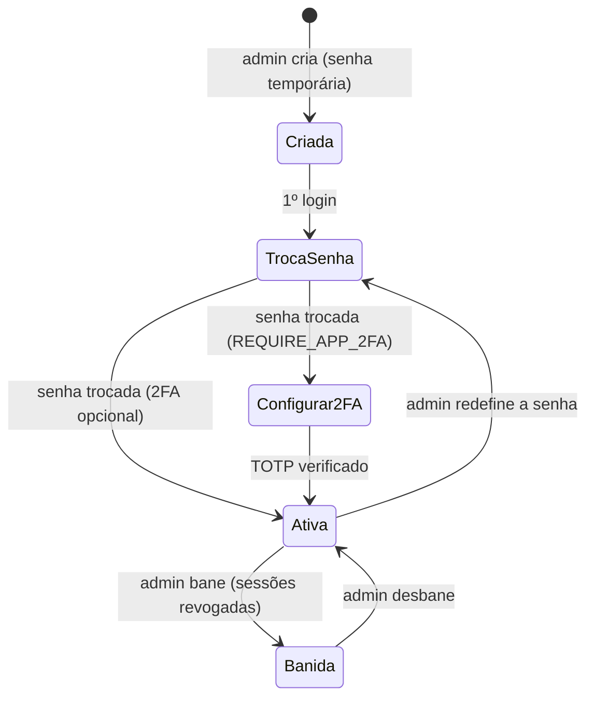

# 03 — Autenticação (better-auth)

> **Implementação** — `src/server/auth/`. Pontos que divergem/complementam o desenho abaixo estão em [§8](#8-implementação-o-que-os-testes-revelaram).

O acesso à ferramenta usa **better-auth 1.7** com usuário + senha, 2FA (TOTP) da ferramenta e gestão de contas pelo admin. O PAT do GitLab **não participa da autenticação**: é uma credencial vinculada à conta depois do login (ver [04](04-integracao-gitlab-api.md)).

## 1. Decisões

| Decisão | Escolha | Motivo |
|---------|---------|--------|
| Identificador de login | **username** (plugin `username`) | Padrão interno; e-mail continua obrigatório no modelo do better-auth |
| Cadastro | **Desabilitado** (`disableSignUp: true`) | Ferramenta administrativa: só o admin cria contas |
| Primeiro admin | Script `scripts/create-admin.ts` usando `auth.api.createUser` no servidor | O endpoint do plugin `admin` aceita chamada server-side sem sessão |
| Hash de senha | scrypt (padrão do better-auth) | Sem dependência nativa. Trocar por argon2 via `emailAndPassword.password.hash/verify` se a Segurança exigir |
| Política de senha | 12–128 caracteres + validação de complexidade via hook `before` | `minPasswordLength`/`maxPasswordLength` nativos; complexidade validada em zod |
| 2FA da ferramenta | Plugin `twoFactor` (TOTP + códigos de backup), **obrigatório** se `REQUIRE_APP_2FA=true` | Ferramenta manipula credenciais de admin GitLab |
| Recuperação de senha | Feita pelo admin (`auth.api.setUserPassword`) + troca obrigatória no próximo login | Sem servidor de e-mail no MVP |
| Sessão | Tabela `session` do better-auth, cookie `httpOnly` com prefixo `gw` | Revogação server-side; listagem de sessões ativas |
| Papéis | Plugin `admin`: `user` (padrão) e `admin` | `admin` gerencia contas e vê a auditoria global |
| Rate limit | Nativo do better-auth com `storage: "database"` | Funciona com mais de uma réplica |

## 2. Configuração do servidor

```ts
// src/server/auth/auth.ts
import 'server-only';
import { betterAuth } from 'better-auth';
import { prismaAdapter } from 'better-auth/adapters/prisma';
import { nextCookies } from 'better-auth/next-js';
import { admin, twoFactor, username } from 'better-auth/plugins';
import { createAuthMiddleware } from 'better-auth/api';
import { prisma } from '@/server/db';
import { env } from '@/server/env';
import { auditAuthEvent } from '@/server/services/audit.service';

export const auth = betterAuth({
  appName: 'GitLab Wizard',
  baseURL: env.BETTER_AUTH_URL,
  secret: env.BETTER_AUTH_SECRET,
  database: prismaAdapter(prisma, { provider: 'postgresql' }),

  emailAndPassword: {
    enabled: true,
    disableSignUp: true,
    minPasswordLength: 12,
    maxPasswordLength: 128,
    revokeSessionsOnPasswordReset: true,
  },

  user: {
    additionalFields: {
      mustChangePassword: { type: 'boolean', defaultValue: true, input: false },
    },
  },

  session: {
    expiresIn: env.SESSION_IDLE_MINUTES * 60, // expira após N minutos sem uso
    updateAge: 5 * 60,                         // renova a expiração a cada 5 min de uso
    freshAge: env.FRESH_SESSION_MINUTES * 60,
    cookieCache: { enabled: true, maxAge: 60 }, // no máx. 60 s de defasagem após revogação
  },

  rateLimit: {
    enabled: true,
    storage: 'database',
    customRules: {
      '/sign-in/username': { window: 60, max: 5 },
      '/two-factor/verify-totp': { window: 60, max: 5 },
      '/two-factor/verify-backup-code': { window: 60, max: 5 },
    },
  },

  advanced: {
    cookiePrefix: 'gw',
    useSecureCookies: true,
    ipAddress: { ipAddressHeaders: ['x-forwarded-for'] }, // ajustar ao proxy reverso
  },

  hooks: {
    after: createAuthMiddleware(async (ctx) => {
      // auditoria de login com sucesso/falha, troca de senha, 2FA ligado/desligado,
      // ações do plugin admin (createUser, setUserPassword, banUser, setRole...)
      await auditAuthEvent(ctx);
    }),
  },

  plugins: [
    username({ minUsernameLength: 3, maxUsernameLength: 32 }),
    twoFactor({ issuer: 'GitLab Wizard' }),
    admin({ defaultRole: 'user', adminRoles: ['admin'] }),
    nextCookies(), // precisa ser o último: grava cookies em Server Actions
  ],
});

export type Session = typeof auth.$Infer.Session;
```

Pontos de atenção:
- O `cookieCache` evita uma consulta ao banco por requisição, mas atrasa em até `maxAge` a percepção de uma sessão revogada ou de um usuário banido. Para **ações sensíveis**, o guard chama `getSession` com `disableCookieCache: true`.
- `mustChangePassword` é `input: false`: o usuário não consegue alterá-lo pela API pública. A ferramenta o atualiza no servidor após `changePassword` e o liga de volta quando o admin redefine a senha.
- O better-auth não tem duração **absoluta** de sessão: `expiresIn` + `updateAge` formam uma expiração deslizante. O guard aplica o limite absoluto `SESSION_MAX_AGE_HOURS` comparando com `session.createdAt` e revoga a sessão se passar dele.

## 3. Route handler e client

```ts
// src/app/api/auth/[...all]/route.ts
import { toNextJsHandler } from 'better-auth/next-js';
import { auth } from '@/server/auth/auth';

export const { GET, POST } = toNextJsHandler(auth);
```

```ts
// src/lib/auth-client.ts
import { createAuthClient } from 'better-auth/react';
import { adminClient, twoFactorClient, usernameClient, inferAdditionalFields } from 'better-auth/client/plugins';
import type { auth } from '@/server/auth/auth';

export const authClient = createAuthClient({
  plugins: [
    usernameClient(),
    twoFactorClient({ onTwoFactorRedirect: () => { window.location.href = '/login/2fa'; } }),
    adminClient(),
    inferAdditionalFields<typeof auth>(),
  ],
});
```

Uso no client: `authClient.signIn.username`, `authClient.twoFactor.verifyTotp` / `verifyBackupCode` / `enable` / `disable`, `authClient.changePassword`, `authClient.listSessions` / `revokeSession` / `revokeOtherSessions`, `authClient.signOut`.

As ações de **admin da ferramenta** (criar conta, redefinir senha, banir, mudar papel) são feitas por **Server Actions** que chamam `auth.api.*` com `headers: await headers()`. Assim dá para validar com zod, exigir sessão recente e auditar com o motivo.

## 4. Proteção de rotas

### 4.1 `proxy.ts` (Next 16): checagem otimista

```ts
// src/proxy.ts
import { NextResponse, type NextRequest } from 'next/server';
import { getSessionCookie } from 'better-auth/cookies';

export function proxy(request: NextRequest) {
  if (!getSessionCookie(request, { cookiePrefix: 'gw' })) {
    return NextResponse.redirect(new URL('/login', request.url));
  }
  return NextResponse.next();
}

export const config = {
  matcher: ['/((?!api/auth|api/health|login|_next/static|_next/image|favicon.ico).*)'],
};
```

O proxy **não** valida a sessão. Ele só evita renderizar páginas para quem claramente não tem cookie.

### 4.2 Guards no servidor: a autorização de verdade

```ts
// src/server/auth/guards.ts
import 'server-only';
import { cache } from 'react';
import { headers } from 'next/headers';
import { redirect } from 'next/navigation';
import { auth } from './auth';

export const getSession = cache(async (opts?: { fresh?: boolean }) =>
  auth.api.getSession({
    headers: await headers(),
    query: opts?.fresh ? { disableCookieCache: true } : undefined,
  }),
);

export async function requireSession() {
  const s = await getSession();
  if (!s) redirect('/login');
  if (isOverAbsoluteLifetime(s.session)) { await revokeCurrent(s); redirect('/login?expired=1'); }
  return s;
}

/** Ações GitLab e de admin: sessão sem cache e login recente (sessão "fresca"). */
export async function requireFreshSession() {
  const s = await getSession({ fresh: true });
  if (!s) throw new ActionError('UNAUTHENTICATED');
  if (Date.now() - s.session.createdAt.getTime() > env.FRESH_SESSION_MINUTES * 60_000) {
    throw new ActionError('REAUTH_REQUIRED'); // a UI pede reautenticação (senha + TOTP)
  }
  return s;
}

export async function requireAdmin() {
  const s = await requireFreshSession();
  if (s.user.role !== 'admin') throw new ActionError('FORBIDDEN');
  return s;
}
```

| Onde | Guard |
|------|-------|
| `(app)/layout.tsx` e páginas | `requireSession()` + redirecionamentos de troca de senha, configuração de 2FA etc. |
| Server Actions GitLab (desbloquear, resetar MFA, rotacionar, vincular PAT) | `requireFreshSession()` + `requireCapability()` |
| Server Actions de admin da ferramenta | `requireAdmin()` |
| Leitura de auditoria global | `requireSession()` + `role === 'admin'` |

**Reautenticação**: quando uma action retorna `REAUTH_REQUIRED`, a UI abre um modal pedindo senha (e TOTP), refaz o login (`signIn.username`, gerando uma sessão nova) e reenvia a action.

## 5. Ciclo de vida da conta



- **Criação** (`createToolUser` → `auth.api.createUser`): username, nome, e-mail, papel e senha temporária gerada (exibida uma vez para o admin entregar ao usuário por canal seguro). `mustChangePassword = true`.
- **Redefinição** (`resetToolUserPassword` → `auth.api.setUserPassword` + `revokeUserSessions`): nova senha temporária, `mustChangePassword = true`.
- **Banimento** (`banUser`): revoga as sessões. O PAT vinculado fica intacto, mas inutilizável enquanto a conta estiver banida.
- **Desativar o 2FA de um usuário** que perdeu o autenticador: o admin redefine a senha **e** remove o 2FA (atualização de `twoFactorEnabled` + exclusão do registro `twoFactor` via service), com auditoria e motivo obrigatório.
- O admin **não pode** banir a si mesmo, nem remover o último admin (validação na action).

## 6. Seed do primeiro admin

```ts
// scripts/create-admin.ts  (executar: node --env-file=.env scripts/create-admin.ts)
import { auth } from '@/server/auth/auth';

const password = generateStrongPassword(); // 20+ chars
await auth.api.createUser({
  body: {
    email: process.env.SEED_ADMIN_EMAIL!,
    name: process.env.SEED_ADMIN_NAME!,
    password,
    role: 'admin',
    data: { username: process.env.SEED_ADMIN_USERNAME! },
  },
});
console.log(`Admin criado. Senha temporária (troque no 1º login): ${password}`);
```

O script recusa rodar se já existir algum usuário com `role = admin`.

## 7. Eventos de autenticação auditados

| Evento | Origem |
|--------|--------|
| `AUTH_LOGIN_SUCCESS` / `AUTH_LOGIN_FAILED` | hook `after` em `/sign-in/username`, `/two-factor/verify-*` |
| `AUTH_LOGOUT` | hook `after` em `/sign-out` |
| `AUTH_PASSWORD_CHANGED` | hook `after` em `/change-password` |
| `AUTH_2FA_ENABLED` / `AUTH_2FA_DISABLED` | hook `after` em `/two-factor/enable` / `disable` |
| `AUTH_RATE_LIMITED` | resposta 429 do handler |
| `TOOL_USER_CREATED`, `TOOL_USER_PASSWORD_RESET`, `TOOL_USER_BANNED`, `TOOL_USER_UNBANNED`, `TOOL_USER_ROLE_CHANGED`, `TOOL_USER_2FA_RESET`, `TOOL_USER_SESSIONS_REVOKED` | Server Actions de admin |

Falhas de login gravam o username informado (sem a senha) e o IP. Não informam ao usuário se o problema foi o username ou a senha.

## 8. Implementação: o que os testes revelaram

| Tema | Comportamento implementado |
|------|----------------------------|
| **Superfície HTTP** | O handler `/api/auth/*` aceita só uma **allowlist** (`HTTP_ALLOWED` em `auth.ts`): login, logout, sessão, troca de senha, sessões e 2FA. `sign-up`, **todo `/admin/*`**, `update-user`, `change-email`, `send-otp`… respondem 404 — mesmo para um admin logado. O plugin `admin` só é usado por Server Actions (`auth.api.*`, sem `request`), onde há sessão fresca, motivo e auditoria |
| **CSRF / origem** | `disableOriginCheck: false` e `disableCSRFCheck: false` **explícitos**: o default do better-auth desliga a checagem de origem quando `NODE_ENV=test`. Requisição com cookie válido e `Origin` de outro site → 403 (teste) |
| **`mustChangePassword`** | `additionalFields` com `input:false`; limpo no hook `after` de `/change-password` (não por action). O cookie cache (60 s) pode estar defasado logo após a troca, então o guard confirma no banco antes de barrar e o client renova o cookie (`getSession` sem cache) |
| **Gates** | Grupo de rotas `(gate)` (troca de senha, `/setup-2fa`) exige sessão sem aplicar os gates, evitando loop de redirecionamento; `(app)` aplica `mustChangePassword` → 2FA obrigatório |
| **Auditoria de login** | `LOGIN_SUCCESS` só quando o login **completa** (com 2FA, na verificação do código). O hook roda antes do plugin `twoFactor`, então detecta o 2FA pendente pelo estado do usuário. Ativação do 2FA × login 2FA se distinguem pelo cookie temporário `two_factor`. O `429` do rate limit é auditado no wrapper `authHandler` (ele responde antes dos hooks) |
| **Rate limit** | Login: `AUTH_RATE_LIMIT_SIGNIN_MAX`/min por IP. `/two-factor/*` tem regra embutida de **3 requisições/10 s**. Sem `CLIENT_IP_HEADER` o IP é desconhecido e todos dividem **um balde por rota** (seguro contra bypass, mas global) — o app avisa no boot. O 2FA também tem bloqueio por tentativas (`failedVerificationCount`/`lockedUntil`) |
| **Reautenticação** | `ReauthProvider` (client) envolve as Server Actions sensíveis: `REAUTH_REQUIRED` → modal de senha (+ TOTP) → novo login (sessão nova e fresca) → repete a action **uma vez**. Erros 429 aparecem como "muitas tentativas", não como "código inválido" |
| **Sessão** | `expiresIn` = inatividade (`SESSION_IDLE_MINUTES`); teto absoluto (`SESSION_MAX_AGE_HOURS`) aplicado nos guards; ações sensíveis leem a sessão **sem cache**. Cookie `gw.session_token` (`__Secure-` em https), `HttpOnly`, `SameSite=Lax` |
| **Banimento** | Revoga as sessões no banco; páginas podem continuar abertas por até 60 s (cookie cache), mas **qualquer ação sensível é negada na hora** (E2E) |
| **Primeiro admin** | `scripts/create-admin.mts` (tsx, `--conditions=react-server` para o `server-only`); recusa se já houver admin ativo; senha temporária impressa uma vez |
| **Recuperação do 2FA do admin** | Outro admin usa *Resetar 2FA*. Se não houver outro admin, ver o [runbook](12-runbook.md#7-incidentes) |
