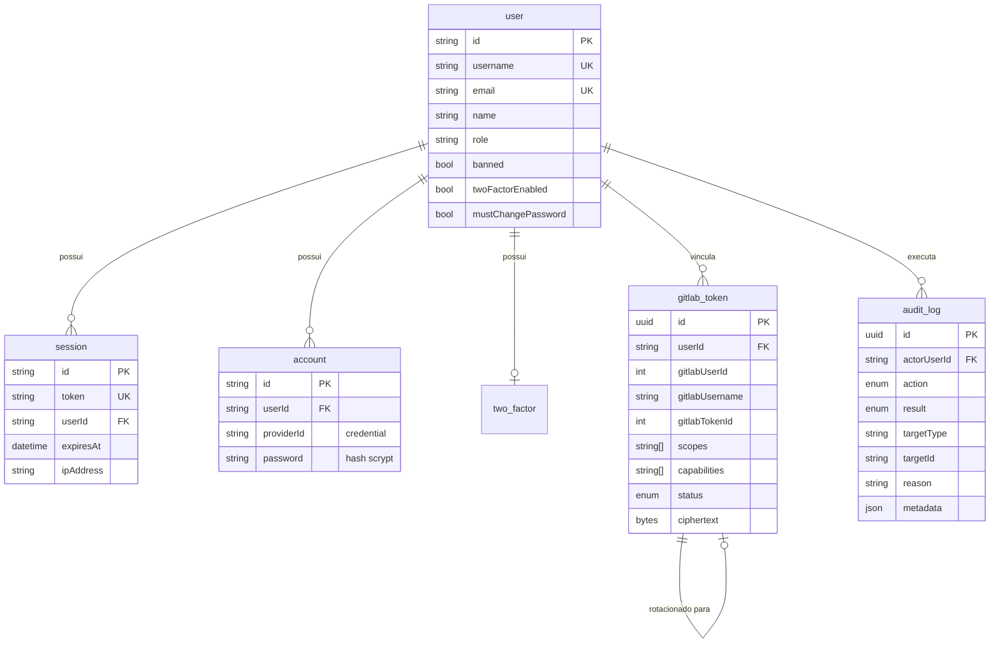

# 05 — Modelo de dados

PostgreSQL 18 com **Prisma 7.10**. Um único `schema.prisma` contém:
- **modelos do better-auth**, gerados pela CLI (`npx auth@latest generate`) e **não editados à mão**, exceto pelos campos adicionais declarados em `auth.ts`;
- **modelos da aplicação**: `GitLabToken` e `AuditLog`.

## 1. Configuração do Prisma 7

```ts
// prisma.config.ts
import { defineConfig, env } from 'prisma/config';

export default defineConfig({
  schema: 'prisma/schema.prisma',
  migrations: { path: 'prisma/migrations' },
  datasource: { url: env('DATABASE_URL') },
});
```

```ts
// src/server/db.ts
import 'server-only';
import { PrismaPg } from '@prisma/adapter-pg';
import { PrismaClient } from '@/generated/prisma/client';
import { env } from './env';

const globalForPrisma = globalThis as unknown as { prisma?: PrismaClient };

export const prisma =
  globalForPrisma.prisma ??
  new PrismaClient({ adapter: new PrismaPg({ connectionString: env.DATABASE_URL }) });

if (process.env.NODE_ENV !== 'production') globalForPrisma.prisma = prisma;
```

## 2. Diagrama



## 3. Schema

```prisma
generator client {
  provider = "prisma-client"
  output   = "../src/generated/prisma"
}

datasource db {
  provider = "postgresql"
}

// ─────────────────────────────────────────────────────────────
// better-auth — GERADO por `npx auth@latest generate`. Não editar.
// Referência do que é esperado com os plugins username, twoFactor, admin
// e rateLimit.storage = "database".
// ─────────────────────────────────────────────────────────────
model User {
  id                 String        @id
  name               String
  email              String        @unique
  emailVerified      Boolean       @default(false)
  image              String?
  createdAt          DateTime      @default(now())
  updatedAt          DateTime      @updatedAt
  username           String?       @unique
  displayUsername    String?
  twoFactorEnabled   Boolean?      @default(false)
  role               String?
  banned             Boolean?      @default(false)
  banReason          String?
  banExpires         DateTime?
  mustChangePassword Boolean?      @default(true)  // additionalFields
  sessions           Session[]
  accounts           Account[]
  twofactors         TwoFactor[]
  gitlabTokens       GitLabToken[]
  auditLogs          AuditLog[]

  @@map("user")
}

model Session {
  id             String   @id
  expiresAt      DateTime
  token          String   @unique
  createdAt      DateTime @default(now())
  updatedAt      DateTime @updatedAt
  ipAddress      String?
  userAgent      String?
  userId         String
  impersonatedBy String?
  user           User     @relation(fields: [userId], references: [id], onDelete: Cascade)

  @@index([userId])
  @@map("session")
}

model Account {
  id         String   @id
  accountId  String
  providerId String
  userId     String
  password   String?
  // ... demais campos OAuth gerados (accessToken, refreshToken, idToken, scope...)
  createdAt  DateTime @default(now())
  updatedAt  DateTime @updatedAt
  user       User     @relation(fields: [userId], references: [id], onDelete: Cascade)

  @@index([userId])
  @@map("account")
}

model Verification { /* gerado */ @@map("verification") }
model TwoFactor    { /* gerado: id, secret, backupCodes, userId, verified, failedVerificationCount, lockedUntil */ @@map("twoFactor") }
model RateLimit    { /* gerado: id, key, count, lastRequest (BigInt, epoch ms) */ @@map("rateLimit") }

// ─────────────────────────────────────────────────────────────
// Aplicação
// ─────────────────────────────────────────────────────────────
enum GitLabTokenStatus {
  ACTIVE           // em uso
  ROTATED          // substituído por rotação feita na ferramenta
  REPLACED         // substituído manualmente pelo usuário
  REVOKED          // GitLab respondeu 401
  REVOKED_UNKNOWN  // rotação com resultado ambíguo
}

model GitLabToken {
  id             String            @id @default(uuid(7)) @db.Uuid
  userId         String            @map("user_id")
  user           User              @relation(fields: [userId], references: [id], onDelete: Restrict)

  gitlabBaseUrl  String            @map("gitlab_base_url")   // preparado para multi-instância
  gitlabUserId   Int               @map("gitlab_user_id")
  gitlabUsername String            @map("gitlab_username")
  gitlabIsAdmin  Boolean           @map("gitlab_is_admin")
  gitlabTokenId  Int               @map("gitlab_token_id")
  name           String
  scopes         String[]
  capabilities   String[]
  expiresAt      DateTime?         @map("expires_at") @db.Date
  status         GitLabTokenStatus @default(ACTIVE)

  // AES-256-GCM — AAD = `${userId}:${id}`
  ciphertext     Bytes?
  iv             Bytes?
  authTag        Bytes?            @map("auth_tag")
  keyVersion     String            @map("key_version")
  fingerprint    String            // SHA-256(token) truncado em 8 hex, só para diagnóstico

  rotatedFromId  String?           @unique @map("rotated_from_id") @db.Uuid
  rotatedFrom    GitLabToken?      @relation("Rotation", fields: [rotatedFromId], references: [id])
  rotatedTo      GitLabToken?      @relation("Rotation")

  createdAt      DateTime          @default(now()) @map("created_at")
  inactivatedAt  DateTime?         @map("inactivated_at")

  @@index([userId, status])
  @@map("gitlab_token")
}

enum AuditResult {
  SUCCESS
  FAILURE
  PARTIAL
  UNKNOWN
}

model AuditLog {
  id            String      @id @default(uuid(7)) @db.Uuid
  actorUserId   String?     @map("actor_user_id")
  actor         User?       @relation(fields: [actorUserId], references: [id], onDelete: SetNull)
  actorUsername String?     @map("actor_username")  // redundante de propósito: sobrevive a mudanças em user
  action        String      // ver catálogo abaixo (validado por zod; string para evoluir sem migration)
  result        AuditResult
  targetType    String?     @map("target_type")     // 'gitlab_user' | 'tool_user' | 'gitlab_token'
  targetId      String?     @map("target_id")
  targetLabel   String?     @map("target_label")    // username do alvo
  reason        String?
  errorCode     String?     @map("error_code")
  metadata      Json?       // { stateBefore, stateAfter, expiresAt, requestId, ... }
  ipAddress     String?     @map("ip_address")
  userAgent     String?     @map("user_agent")
  createdAt     DateTime    @default(now()) @map("created_at")

  @@index([actorUserId, createdAt])
  @@index([targetType, targetId, createdAt])
  @@index([action, createdAt])
  @@map("audit_log")
}
```

> **Implementação:** o schema completo e atual está em `prisma/schema.prisma` (gerado/conferido com `npm run auth:generate`). `GitLabToken.id` é gerado pela aplicação (precisa existir antes de cifrar, por causa do AAD). Os índices parciais e o `REVOKE` estão na migration `…_init` (o `REVOKE` só se aplica se o papel `app_runtime` existir).

> `uuid(7)` (ordenável por tempo) é suportado no Prisma 6+. Os IDs do better-auth são strings geradas por ele; a aplicação não interfere nelas.

## 4. Catálogo de ações de auditoria

| Grupo | Ações |
|-------|-------|
| Autenticação | `AUTH_LOGIN_SUCCESS`, `AUTH_LOGIN_FAILED`, `AUTH_LOGOUT`, `AUTH_PASSWORD_CHANGED`, `AUTH_2FA_ENABLED`, `AUTH_2FA_DISABLED`, `AUTH_RATE_LIMITED`, `AUTH_SESSION_REVOKED` |
| Admin da ferramenta | `TOOL_USER_CREATED`, `TOOL_USER_PASSWORD_RESET`, `TOOL_USER_BANNED`, `TOOL_USER_UNBANNED`, `TOOL_USER_ROLE_CHANGED`, `TOOL_USER_2FA_RESET`, `TOOL_USER_SESSIONS_REVOKED` |
| PAT | `GITLAB_TOKEN_LINKED` ("token adicionado"), `GITLAB_TOKEN_DEFAULT_CHANGED` (de/para), `GITLAB_TOKEN_REPLACED`, `GITLAB_TOKEN_ROTATION_STARTED`, `GITLAB_TOKEN_ROTATED`, `GITLAB_TOKEN_UNLINKED`, `GITLAB_TOKEN_INVALIDATED` |
| GitLab | `GITLAB_USER_BLOCKED`, `GITLAB_USER_UNBLOCKED`, `GITLAB_USER_2FA_DISABLED` |
| Auditoria | `AUDIT_EXPORTED` |
| Configurações | `SETTINGS_CHANGED` (metadata: chave, antes, depois) |
| Limpeza de credenciais | `GITLAB_CLEANUP_SCANNED`, `GITLAB_CLEANUP_PAT_REVOKED`, `GITLAB_CLEANUP_SSH_KEY_DELETED` (um por item), `GITLAB_CLEANUP_EXECUTED` (resumo) |
| Políticas GitLab | `GITLAB_POLICY_PAT_LIFETIME_SIMULATED`, `GITLAB_POLICY_PAT_LIFETIME_APPLIED` |

## 5. Regras de integridade (migration SQL manual)

```sql
-- Uma conta pode ter VÁRIOS tokens ativos, mas exatamente UM padrão
CREATE UNIQUE INDEX gitlab_token_one_default_per_user
  ON gitlab_token (user_id) WHERE status = 'ACTIVE' AND is_default;

-- Um usuário GitLab é o padrão de, no máximo, uma conta (toda conta com tokens ativos tem um padrão,
-- logo o mesmo usuário GitLab não fica em duas contas)
CREATE UNIQUE INDEX gitlab_token_one_default_per_gitlab_user
  ON gitlab_token (gitlab_base_url, gitlab_user_id) WHERE status = 'ACTIVE' AND is_default;

-- O mesmo PAT (id no GitLab) não pode estar ativo duas vezes
CREATE UNIQUE INDEX gitlab_token_one_active_per_pat
  ON gitlab_token (gitlab_base_url, gitlab_token_id) WHERE status = 'ACTIVE';

-- Auditoria append-only para o usuário de runtime da aplicação
REVOKE UPDATE, DELETE, TRUNCATE ON audit_log FROM app_runtime;
```

- **Padrão (`is_default`)**: invariante *"conta com tokens ativos ⇒ exatamente um padrão"*, mantido em transação (`ensureDefault`): ao remover, revogar (401) ou ficar `REVOKED_UNKNOWN`, o token **mais recente** dos que restam assume. Rotacionar/substituir transfere a condição de padrão ao novo token. A regra *"todos os tokens da conta são do mesmo usuário GitLab"* é do código (`GITLAB_USER_MISMATCH`). Migração `…_multiple_tokens_default` faz o backfill (o único ativo de cada conta vira o padrão).
- Usuários de banco separados: `app_migrator` (DDL, usado só no deploy) e `app_runtime` (DML, sem `UPDATE`/`DELETE` em `audit_log`).
- `metadata` **nunca** guarda token, ciphertext, senha ou e-mail do usuário GitLab alvo.
- Contas da ferramenta **não são excluídas**, apenas banidas, para preservar a auditoria (`onDelete: Restrict` em `GitLabToken`).

## 6. Retenção

| Dado | Retenção | Mecanismo |
|------|----------|-----------|
| `session` expiradas | Removidas após 7 dias | Job diário |
| `rate_limit` | Linhas com mais de 1 dia removidas | Job diário |
| `gitlab_token` não ativos | `ciphertext/iv/authTag` → `NULL` 30 dias após inativação; metadados mantidos | Job diário |
| `audit_log` | 5 anos ou mais (validar a política) | Particionamento por ano se o volume crescer |

Os jobs rodam por um endpoint interno protegido (`/api/internal/maintenance`, autenticado por segredo) acionado por um CronJob do orquestrador.

## 7. Tabelas das configurações e das varreduras

- **`app_setting`** (`key`, `value` JSON, `updated_by`): configurações editáveis na tela — `cleanup.inactivityDays` (1–3650, padrão 90) e `pat.maxLifetimeDays` (1–365, padrão = `TOKEN_MAX_LIFETIME_DAYS` do `.env`). Valor ausente ou inválido volta ao padrão. Também guarda `vault.config` (JSON: grupo raiz, dias de alerta, validade, escopos e papel do token do cofre — [13](13-cofre-de-tokens-de-projeto.md)). `admin_scan.kind` ganhou o valor `VAULT`; `gitlab_token.capabilities` ganhou `VAULT_TOKENS`.
- **`admin_scan`** (`kind` CLEANUP | PAT_LIFETIME, `status`, `params`, `progress`, `items`, `summary`): resultado da varredura/simulação. **A execução só age sobre itens que constam aqui** (o client envia apenas chaves como `PAT:123`, nunca ids livres) e só o admin que criou a varredura a enxerga. Contém usernames e títulos de chaves, **nunca segredos**; removida pela manutenção após 30 dias. Varredura `RUNNING` sem sinal de vida por 3 min vira `FAILED` (o processo pode ter reiniciado).
